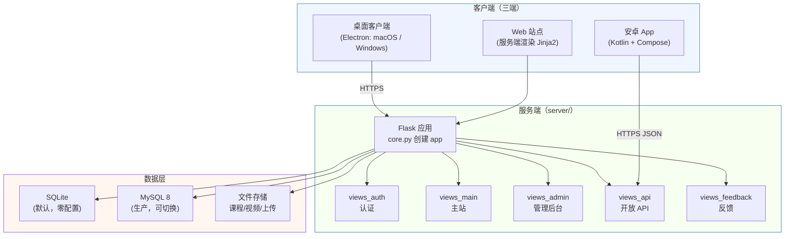

# 教学管理系统（teaching-system）

> 一个面向高校实验室/实训基地的**全端一体化教学平台**：Web 站点 + 安卓 App + macOS/Windows 桌面客户端，一套后端服务全部支撑。

[](LICENSE)
[](server)
[](server)
[](android)
[](desktop)

---

## 目录

- [项目简介](#项目简介)
- [功能特性](#功能特性)
- [系统架构](#系统架构)
- [技术栈](#技术栈)
- [目录结构](#目录结构)
- [快速开始](#快速开始)
- [新手配置指南（零基础）](配置指南.md)
- [配置说明](#配置说明)
- [部署](#部署)
- [迭代指南](#迭代指南)
- [贡献指南](#贡献指南)
- [安全说明](#安全说明)
- [许可证](#许可证)

---

## 项目简介

**教学管理系统**是一套面向高校网络/工科实训场景的教学管理平台，核心解决「课程学习、进度管理、作业考试、社区互动、多端分发」一条龙需求。

- **给谁用**：实验室老师（管理员）、学生（学员）、实验室管理员。
- **解决什么问题**：把分散的课程资料、视频、作业、考试、打卡、社区，统一到一个账号体系 + 三个客户端形态里。
- **为什么多端**：Web 方便管理，安卓方便学生手机学习，桌面客户端（macOS/Windows）适合机房/实验室固定终端。

## 功能特性

| 模块 | 说明 |
|------|------|
| 👤 账号体系 | 注册 / 登录 / 找回密码 / 扫码登录（Web 生成二维码，App 扫码）/ 注销账号 |
| 📚 课程学习 | 课程目录、视频点播、学习进度记录、每日学习打卡（study_days） |
| 🧪 挑战赛 | 挑战任务、比赛匹配、挑战记录（challenge / challenge_matches / challenge_records） |
| 💬 社区 | 帖子 / 回复 / 附件（posts / replies / post_attachments） |
| 📝 作业与考试 | 作业布置与提交（assignments）、在线考试（questions / exams / attempts） |
| 🔑 激活码授权 | 激活码按范围解锁（全部 / 按标签 / 指定课程） |
| 📢 公告 | 管理员发布公告，多端弹出展示 |
| 📮 反馈 | 用户反馈（含图片）、管理员回复 |
| 🧰 在线工具 | 格式转换（PDF/Word 等）、网络工具、编解码工具 |
| 📱 客户端版本管理 | 上传 APK/安装包自动解析版本号，多端 OTA 升级提示 |
| 🛠 管理后台 | 用户 / 课程 / 视频 / 作业 / 考试 / 公告 / 激活码 / 反馈 全量管理 |

## 系统架构



**核心设计**：

1. **一套后端、多端复用**：安卓和桌面客户端都通过 `views_api` 暴露的 JSON 接口与后端通信，Web 站则是服务端渲染（Jinja2 模板）。
2. **数据库统一为 MySQL 8**：不再支持 SQLite。`server/app/db.py` 里的 390 条 SQL 仍是 SQLite 写法，运行时由 `mysqldialect.py` 翻译成 MySQL 方言（业务代码一行不用改）；建库建表由 `init_db()` 在首次启动时自动完成（需提前建好 `netlab` 库，见 [配置说明](#配置说明) 与 [新手配置指南（零基础）](配置指南.md)）。
3. **客户端 URL 集中配置**：每个客户端的服务端地址都是一个常量（安卓 `Api.kt` 的 `BASE_URL`，桌面 `main.js` 的 `SITE_ORIGIN`），部署到自有服务器时只需改这一处。

## 技术栈

| 端 | 语言/框架 | 关键依赖 | 构建 |
|----|-----------|----------|------|
| **服务端 + Web** | Python 3.12 · Flask 3.0 | gunicorn / Apache mod_wsgi · Jinja2 · pymysql · openpyxl · qrcode+Pillow · pdf2docx · pyaxmlparser | `pip` + Docker |
| **安卓 App** | Kotlin · Jetpack Compose | Material3 · Navigation Compose · OkHttp · Coil · coroutines · ZXing（扫码） | Gradle 8.10 / JDK 17 |
| **macOS 客户端** | JavaScript · Electron 33 | electron-builder（dmg / zip，arm64） | `npm run dist` |
| **Windows 客户端** | JavaScript · Electron 33 | electron-builder（NSIS 安装版 / portable 绿色版，x64） | `npm run dist` |
| **数据库** | SQLite / MySQL 8 | pymysql（MySQL 方言层，见 `server/app/mysqldialect.py`） | — |

**系统级依赖**（服务端非 Python 依赖，需单独安装）：

- `ffmpeg` —— 视频字幕 / 音视频处理
- `libreoffice` —— doc / docx / xls 等文档格式互转

## 目录结构

```
.
├── server/                    # Flask 后端 + Web 站点（服务端渲染）
│   ├── app/
│   │   ├── core.py            #   应用工厂：创建 app、注册蓝图、中间件
│   │   ├── db.py              #   数据模型 + SQLite/MySQL 双后端抽象
│   │   ├── mysqldb.py         #   MySQL 方言层
│   │   ├── mysqldialect.py    #   方言辅助
│   │   ├── views_auth.py      #   认证（注册/登录/找回/扫码/注销）
│   │   ├── views_main.py      #   主站页面
│   │   ├── views_admin.py     #   管理后台
│   │   ├── views_api.py       #   供 App/桌面端调用的 JSON API
│   │   ├── views_feedback.py  #   反馈
│   │   ├── throttle.py        #   限流
│   │   ├── subtitle.py        #   字幕处理
│   │   ├── wsgi.py            #   开发入口
│   │   ├── wsgi_entry.py      #   Apache mod_wsgi 生产入口
│   │   ├── templates/         #   Jinja2 模板（54 个）
│   │   ├── static/            #   CSS / JS / 图标
│   │   ├── requirements.txt   #   Python 依赖
│   │   └── Dockerfile         #   容器化
│   └── run.sh                 # 本地一键启动
│
├── android/                   # 安卓 App
│   ├── app/
│   │   ├── build.gradle.kts   #   构建配置（applicationId=com.teachingsystem.web）
│   │   └── src/main/java/com/teachingsystem/web/
│   │       ├── data/Api.kt    #   API 客户端（BASE_URL 在此配置）
│   │       ├── data/Session.kt #   登录会话
│   │       ├── data/Updater.kt #   OTA 升级
│   │       └── ui/            #   Compose 界面
│   ├── build_android.sh       # 一键构建脚本
│   └── gradlew
│
├── desktop/
│   ├── mac/                   # macOS 客户端（Electron）
│   │   ├── src/main.js        #   主进程（SITE_ORIGIN 在此配置）
│   │   ├── src/shell.js       #   外壳导航
│   │   └── package.json       #   electron-builder 配置
│   └── windows/               # Windows 客户端（Electron）
│       ├── src/...
│       └── package.json
│
├── tools/                     # 运维 / 迁移脚本（已脱敏，见安全说明）
│   ├── publish_app.py         #   客户端版本发布
│   ├── db-*.sh / db_push.py   #   数据库备份/同步
│   ├── password-plain.py      #   口令存储切换工具
│   ├── set-password.sh        #   改用户密码
│   └── mysql/                 #   SQLite → MySQL 迁移脚本
│
├── docs/                      # 补充文档
│   ├── getting-started.md     #   开发入门
│   ├── database.md            #   数据库连接与操作
│   └── iteration-manual.html  #   迭代手册
│
└── .gitignore
```

## 快速开始

### 环境要求

| 组件 | 版本要求 |
|------|----------|
| Python | 3.12+ |
| Node.js | 18+（仅桌面端构建需要） |
| JDK | 17（仅安卓构建需要） |
| Android SDK | compileSdk 34（仅安卓构建需要） |
| ffmpeg / libreoffice | 可选，服务端部分功能需要 |

### 0. 一键配置（Windows / macOS / Linux）

仓库根目录提供了跨平台的一键配置脚本，**一条命令装好依赖、生成配置并启动站点**：

```bash
# macOS / Linux
./setup.sh            # 或：python3 setup.py
# Windows（双击，或在 PowerShell / CMD 里运行）
setup.bat             # 或：python setup.py
```

脚本会自动完成：创建 `server/.venv` 虚拟环境 → 安装依赖 → 生成 `.env`（随机 `SECRET_KEY` 与管理员密码）→ 首次启动自动建库与建管理员账号 → 启动 Flask 并打开浏览器。

常用参数：

```bash
python3 setup.py --no-run     # 只装依赖与生成配置，不启动（适合二次部署）
python3 setup.py --port 9000  # 指定端口
python3 setup.py --reinstall  # 强制重建虚拟环境并重装依赖
```

配置项（数据库后端、管理员、密钥等）见 [`.env.example`](.env.example)，生成的 `.env` 已加入 `.gitignore`，请勿提交。

看不懂命令行、想一步步照着点？看 👉 [新手配置指南（零基础）](配置指南.md)。

### 1. 启动服务端 + Web

```bash
cd server
python3 -m venv .venv
.venv/bin/pip install -r app/requirements.txt

# 一键启动开发模式（默认 8000 端口，改代码自动重载）
./run.sh
# 或指定端口：PORT=9000 ./run.sh
```

浏览器打开 <http://127.0.0.1:8000> 即可看到站点。**注意：本系统仅支持 MySQL**，启动前需先安装并运行 MySQL 8、建好 `netlab` 库（账号/密码写在根目录 `.env` 的 `NETLAB_MYSQL_*` 里）。推荐直接跑根目录的一键配置 `./setup.sh`（或 `setup.bat`），它会自动装依赖、生成 `.env` 并尝试建库。

### 2. 构建安卓 App

```bash
cd android
# macOS / Linux
./build_android.sh
# Windows
build_android.bat
```

产物在 `android/app/build/outputs/apk/debug/`。修改服务端地址：编辑 `app/src/main/java/com/teachingsystem/web/data/Api.kt` 里的 `BASE_URL`。

### 3. 构建桌面客户端

```bash
# macOS 客户端
cd desktop/mac
npm install
npm run dist        # 产出 dist/ 下的 dmg + zip

# Windows 客户端
cd desktop/windows
npm install
npm run dist        # 产出 NSIS 安装版 + portable 绿色版
```

修改服务端地址：编辑 `src/main.js` 里的 `SITE_ORIGIN`（以及 `src/shell.js` 里的快捷入口 URL）。

## 配置说明

服务端通过**环境变量**配置，均带安全默认值：

| 环境变量 | 默认值 | 说明 |
|----------|--------|------|
| `DATA_DIR` | `server/data` | 数据文件目录（上传文件、课程资源等；数据库为 MySQL，不落在此目录） |
| `SECRET_KEY` | 开发用固定值 | **生产必须改成随机值**（用于 session/token 签名） |
| `PORT` | `8000` | 监听端口 |
| `BASE_PATH` | 空 | 反向代理子路径 |
| `NETLAB_MYSQL_HOST` | `127.0.0.1` | MySQL 主机（本系统唯一数据库后端） |
| `NETLAB_MYSQL_PORT` | `3306` | MySQL 端口 |
| `NETLAB_MYSQL_USER` | `admin` | MySQL 用户 |
| `NETLAB_MYSQL_PASSWORD` | 空 | MySQL 密码 |
| `NETLAB_MYSQL_DATABASE` | `netlab` | MySQL 库名 |

**数据库后端（MySQL 8）**：把 `NETLAB_MYSQL_*` 写进 `/opt/websystem/db-backend.env`（`KEY=VALUE` 逐行），或直接注入环境变量；`wsgi_entry.py` 会自动读取。本系统只支持 MySQL，未正确配置会在启动时直接报错，而非静默回退到别的后端。详细部署/运维说明见 [docs/database.md](docs/database.md)。

> ⚠️ 任何敏感信息（数据库密码、SECRET_KEY）**不要硬编码进代码**，一律用环境变量注入。本仓库代码中的 `CHANGE_ME_PASSWORD`、`YOUR_SERVER_IP`、`your-server.example.com` 等都是占位符，部署时替换为你的真实值。

## 部署

### Docker（推荐）

```bash
cd server/app
docker build -t teaching-system .
docker run -d --name teaching-system \
  -p 8000:8000 \
  -v /path/to/data:/data \
  -e SECRET_KEY="$(openssl rand -hex 32)" \
  teaching-system
```

### 传统部署（Apache mod_wsgi）

生产入口为 `server/app/wsgi_entry.py`，配合 `wsgi.py` 使用；数据目录与密钥通过环境变量注入。完整生产部署步骤（Nginx/Apache 反向代理、systemd、MySQL 切换）见 [docs/iteration-manual.html](docs/iteration-manual.html)。

## 迭代指南

这个仓库是一个**多端 monorepo**，迭代时按「后端 → API → 各客户端」的节奏推进。常见迭代任务的入口见下表：

| 想做什么 | 改哪里 | 说明 |
|----------|--------|------|
| 加一个后端接口/页面 | `server/app/views_*.py` + `templates/` | 路由在 `core.py` 按蓝图注册 |
| 加一张表/字段 | `server/app/db.py` 的 schema + `ensure_column` | 启动时自动迁移（见 `db.py` 迁移逻辑） |
| 让 App 用上新接口 | `android/.../data/Api.kt` + 对应 `ui/screens/` | 走 `views_api` 的 JSON 接口 |
| 桌面端加导航入口 | `desktop/*/src/shell.js` | 外壳导航菜单 |
| 发布新客户端版本 | `tools/publish_app.py` | 上传安装包 → 写 `app_versions` 表 → 多端 OTA 提示 |
| SQLite ↔ MySQL 切换 | `tools/mysql/switch/` | 一键切换 + 冒烟测试 + 回滚 |

**发布节奏建议**：

1. **后端先行**：改 `server/`，本地 `./run.sh` 验证，跑通后提交。
2. **App/桌面端跟进**：改客户端调用层，本地构建验证。
3. **版本发布**：用 `tools/publish_app.py` 上传新安装包，服务端记录版本号，客户端自动提示升级。
4. **回滚**：版本发布可直接下线旧版本；数据库为单一 MySQL 后端，无需后端切换/回滚。

更详细的开发/迭代流程见 [docs/getting-started.md](docs/getting-started.md) 和 [docs/iteration-manual.html](docs/iteration-manual.html)。

## 贡献指南

欢迎贡献！请先阅读 [CONTRIBUTING.md](CONTRIBUTING.md)。

基本原则：

- **不要提交任何真实凭据/用户数据**：上传文件、安装包、备份都不入库（已在 `.gitignore` 排除）；数据库为 MySQL，不落地为文件。敏感配置一律用环境变量。
- 提交前确保 `server` 下 `.py` 文件能通过语法检查（`python -m py_compile`）。
- 涉及多端的改动，请在同一 PR 里说明后端/接口/各客户端的变更点。

## 安全说明

本仓库是**脱敏后的开源版本**：

- 已移除所有硬编码数据库密码、生产服务器 IP、生产域名、个人邮箱/手机号，统一替换为 `CHANGE_ME_PASSWORD` / `YOUR_SERVER_IP` / `your-server.example.com` 等占位符。
- 视频、课程文件、用户上传、用户数据库（含账号与口令哈希）**均未纳入版本库**（见 `.gitignore`）。
- 若发现仍有遗漏的敏感信息，请通过 issue 或邮件反馈，我们会第一时间处理。

## 许可证

本项目采用 [MIT License](LICENSE) 开源。

---

**致谢**：感谢所有使用和贡献本项目的师生与开发者。
